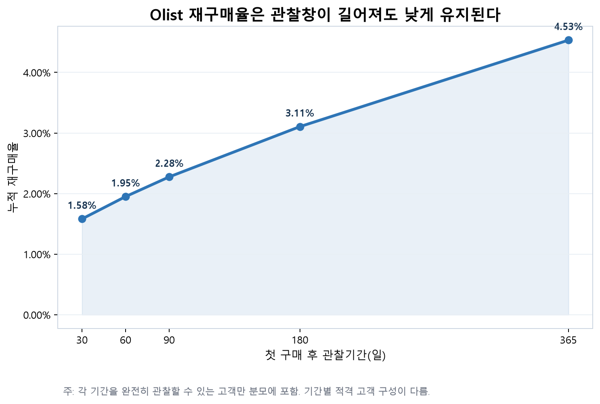
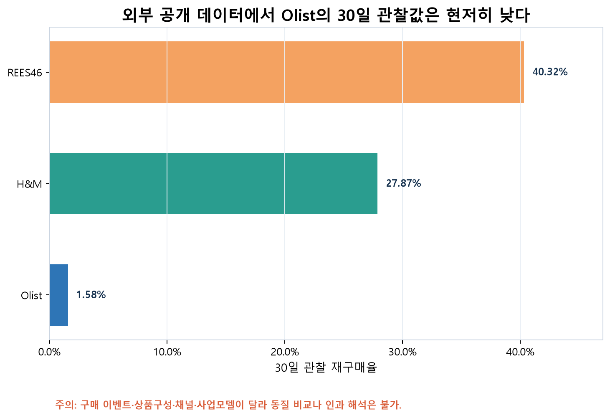
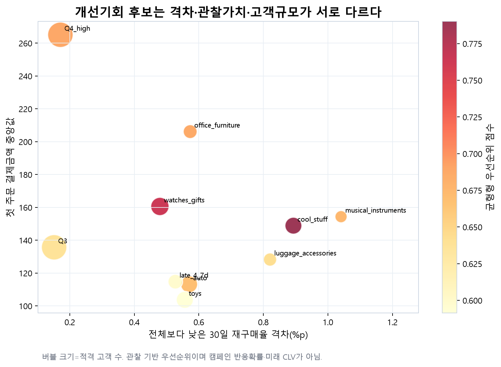
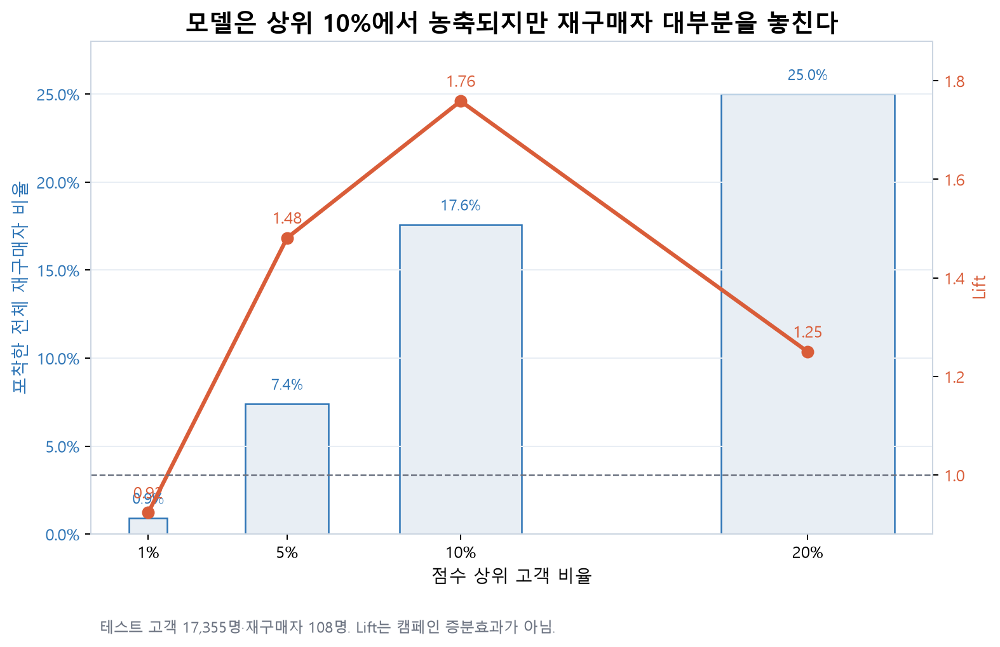
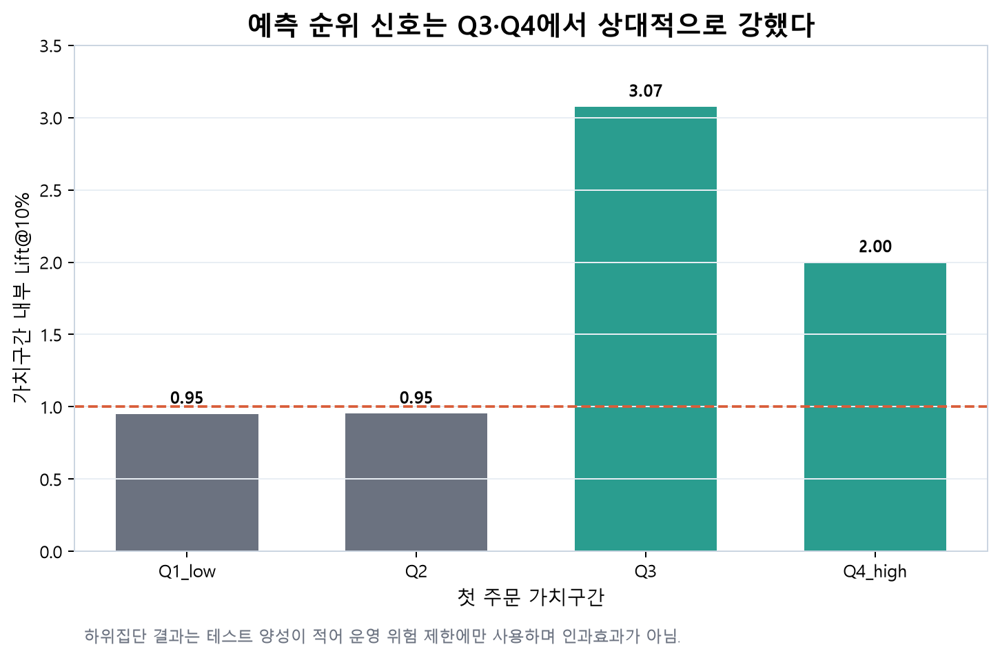
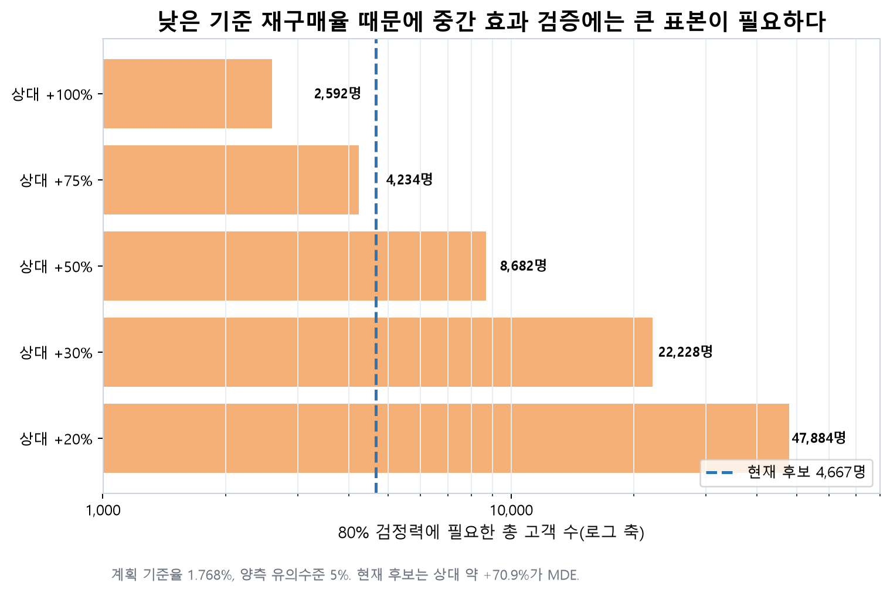

# Olist 고객 재구매 분석 및 CRM 실행 설계 최종 보고서

기준일: 2026-08-03  
분석 범위: Olist 재구매율 진단, H&M·REES46 비교, 개선기회, 예측모델, CRM 무작위 실험 설계  
중요 제한: 실제 CRM 캠페인은 실행되지 않았으며 합성 실험 결과는 코드 검증용이다.

## 1. Executive Summary

Olist의 고객 93,358명 중 전체 관찰기간에 두 번 이상 주문한 고객은 2,801명이다. 완전한 관찰기간을 확보한 고객 기준 공식 재구매율은 30일 1.5823%, 60일 1.9507%, 90일 2.2756%, 180일 3.1052%, 365일 4.5331%다.

외부 데이터의 30일 값은 H&M 27.8685%, REES46 40.3194%로 Olist보다 높다. 그러나 구매 이벤트 정의, 상품구성, 채널, 관찰기간과 사업모델이 달라 이 차이를 Olist 정책의 인과적 열위로 해석할 수 없다.

첫 주문 정보 기반 로지스틱 모델은 테스트 상위 10%에서 Lift 1.7588, Recall 17.59%를 보였다. 무작위보다 재구매자를 농축하지만 대부분의 재구매자를 놓치므로 자동 의사결정 모델이 아니라 제한된 CRM 후보 압축 보조로 사용해야 한다.

Q3·Q4 가치구간 내부 상위 10%인 4,667명을 역사적 CRM 파일럿 후보로 정의했다. 현재 표본의 80% 검정력 MDE는 절대 +1.2530%p, 상대 +70.87%다. 통계적으로는 매우 큰 효과를 탐색하는 후보 규모지만, 동의·채널·계측이 없어 현재 운영에서는 실행할 수 없고 상대 20~30% 정도의 개선을 확정하기에도 부족하다.

현재 런치 게이트는 준비 완료 2개, 보류 3개, 차단 4개다. 실제 캠페인 전에는 동의·채널·빈도제한·CRM/주문/비용 계측 연결이 필요하다.

따라서 본 프로젝트의 현재 결정은 `DO_NOT_LAUNCH`다. Olist 조직에 제안하는 행동은 필요한 운영 조건을 별도로 충족한 경우에만 `CONDITIONAL_RANDOMIZED_PILOT`으로 전환하는 것이며, 캠페인 효과가 입증됐다는 권고가 아니다.

## 2. 프로젝트 목적과 분석 질문

1. Olist의 30·60·90·180·365일 재구매율은 어느 수준인가?
2. 외부 이커머스 데이터와 비교할 때 격차는 어느 정도인가?
3. 고객 규모·재구매율 격차·관찰 고객가치·개입 가능성을 고려하면 어디를 먼저 살펴봐야 하는가?
4. 첫 주문 시점 정보로 재구매 가능 고객을 얼마나 압축할 수 있는가?
5. 모델 점수를 CRM 실험으로 어떻게 연결하고 증분효과를 어떻게 검증해야 하는가?

## 3. 데이터와 KPI 정의

### 3.1 분석 단위

- 고객키: `customer_unique_id`
- 주문키: `order_id`
- 재구매 이벤트: 서로 다른 배송 완료 주문
- 분석 고객: 93,358명
- 재구매 주문 마트: 96,478행
- 관찰 종료시각: 2018-08-29 15:00:37

### 3.2 공식 KPI와 운영 타깃의 구분

| 구분 | 정의 | 결과 | 사용 목적 |
|---|---|---:|---|
| 공식 30일 재구매율 | 첫 주문 후 30일 이내 두 번째 배송 완료 주문 | 1.5823% | 사업 수준 진단·외부 비교 |
| 운영 ML 타깃 | 첫 주문 24시간 초과~30일 이내 두 번째 배송 완료 주문 | 0.6166% | 결제과정 분리 가능성을 줄인 모델·CRM 설계 |

두 수치는 정의가 다르므로 직접 대체하거나 혼합하지 않는다.

## 4. 재구매율 수준 진단

| 관찰창 | 적격 고객 | 재구매 고객 | 재구매율 |
|---:|---:|---:|---:|
| 30일 | 86,772 | 1,373 | 1.5823% |
| 60일 | 81,203 | 1,584 | 1.9507% |
| 90일 | 75,320 | 1,714 | 2.2756% |
| 180일 | 55,907 | 1,736 | 3.1052% |
| 365일 | 21,288 | 965 | 4.5331% |

관찰창이 길어질수록 누적 재구매율은 증가하지만 365일에도 4.5331%다. 이는 Olist 데이터에서 반복 구매가 희소하다는 진단이며, 원인은 이 데이터만으로 확정할 수 없다.

### 4.1 재구매까지 걸리는 시간과 중도절단

Kaplan–Meier 생존분석에서 공식 정의의 누적 재구매 추정치는 30일 1.5275% (95% 구간 1.4504~1.6086%), 365일 3.8655%였다. 24시간 초과 운영 정의의 30일 추정치는 0.6136%다.

전체 관찰기간에 확인된 두 번째 주문 2,801건 중 853건(30.45%)은 첫 주문 후 24시간 이내였다. 따라서 공식 30일 KPI와 24시간 초과 운영 타깃의 차이는 단순 표기 차이가 아니라 실제 주문 시점 구조에서 나온다.

첫 구매 코호트별 공식 30일 Kaplan–Meier 추정치는 2017년 상반기까지 1.8909%, 2017년 하반기 1.7275%, 2018년 상반기 1.3918%였다. 이는 달력 시점에 따라 고객·상품·운영 구성이 달라졌을 가능성을 보여주지만 하락의 원인을 특정하지는 않는다.

Kaplan–Meier 30일 값(1.5275%)과 완전 관찰 고객만 사용한 공식 KPI(1.5823%)가 완전히 같지 않은 이유는, Kaplan–Meier가 관찰기간이 짧은 고객도 중도절단으로 부분 활용하며 중도절단의 독립성을 가정하기 때문이다. 이 데이터에서는 가입 달력 시점과 재구매 수준이 함께 변하므로 공식 고정창 KPI를 교체하지 않고 시간 구조를 설명하는 보조 분석으로만 사용한다.

## 5. 외부 데이터 비교

| 기간 | Olist | H&M | REES46 |
|---:|---:|---:|---:|
| 30일 | 1.5823% | 27.8685% | 40.3194% |
| 60일 | 1.9507% | 39.2867% | 59.6416% |
| 90일 | 2.2756% | 46.6874% | 비교 불가 |
| 180일 | 3.1052% | 59.4731% | 비교 불가 |
| 365일 | 4.5331% | 71.8464% | 비교 불가 |

외부 비교의 허용된 해석은 “공개 데이터 구조에서 Olist의 관찰 재구매율이 현저히 낮다”까지다. 이 격차를 CRM 정책, 서비스 품질 또는 상품경쟁력의 인과효과로 표현하지 않는다.

## 6. 개선기회 우선순위

우선순위는 고객 규모, 전체 대비 재구매율 격차, 첫 주문 결제금액으로 본 관찰 가치, 기업의 개입 가능성을 결합했다. 미래 CLV를 추정한 것이 아니다.

| 순위 | 차원 | 고객군 | 고객 수 | 30일 재구매율 | 균형점수 |
|---:|---|---|---:|---:|---:|
| 1 | primary_category | cool_stuff | 3,337 | 0.689% | 0.790 |
| 2 | primary_category | watches_gifts | 4,895 | 1.103% | 0.764 |
| 3 | order_value_band | Q4_high | 21,748 | 1.412% | 0.689 |
| 4 | primary_category | office_furniture | 1,189 | 1.009% | 0.688 |
| 5 | primary_category | musical_instruments | 554 | 0.542% | 0.675 |
| 6 | primary_category | auto | 3,358 | 1.013% | 0.668 |
| 7 | primary_category | luggage_accessories | 919 | 0.762% | 0.643 |
| 8 | order_value_band | Q3 | 21,732 | 1.431% | 0.638 |
| 9 | delivery_experience_group | late_4_7d | 1,611 | 1.055% | 0.598 |
| 10 | primary_category | toys | 3,509 | 1.026% | 0.591 |

`cool_stuff`, `watches_gifts`, Q4_high 등은 관찰 기반 개선기회 후보다. 우선순위 점수가 캠페인 반응 확률이나 인과효과를 의미하지 않는다.

카테고리 전환 조합 대부분은 고객 수가 매우 적었다. 따라서 특정 교차판매 경로를 확정하기보다 카테고리 규칙은 메시지 콘텐츠 가설로만 사용한다.

## 7. 예측모델

### 7.1 설계

- 예측시점: 첫 주문 시점
- 타깃: 첫 주문 24시간 초과~30일 이내 후속 배송 완료 주문
- 최종 모델: L2 로지스틱 회귀, `C=0.01`
- 데이터 분할: 시간순 학습·선택·보정·테스트
- 주요 평가: PR-AUC, Calibration, Lift, Recall

### 7.2 독립 테스트 결과

| 지표 | 결과 |
|---|---:|
| 테스트 고객 | 17,355명 |
| 테스트 재구매자 | 108명 |
| PR-AUC | 0.007821 |
| ROC-AUC | 0.542233 |
| 상위 10% Lift | 1.758753 |
| 상위 10% Recall | 17.5926% |
| 상위 10% 고객 | 1,736명 |
| 포착 재구매자 | 19명 |

4개 연속 미래기간의 Lift@10%는 1.6044~2.1046로 모두 1보다 높았다. 다만 세부 고객군 106개 중 충분한 기술 표본을 가진 그룹은 21개뿐이며 85개는 희소했다.

### 7.3 운영 해석

- 적절: 제한된 발송 후보의 우선순위 보조
- 부적절: 개인별 구매 여부 확정, 캠페인 효과 주장, 광범위 자동 의사결정
- Q3·Q4 내부 Lift는 상대적으로 높았지만 Q1·Q2는 약 0.95였다.
- 전체 상위군은 SP와 `bed_bath_table`에 집중되어 구성비 모니터링이 필요하다.

### 7.4 멀티호라이즌 연구 부록

동결된 30일 로지스틱 점수를 독립 테스트 고객의 30·60·90일 운영 타깃에 그대로 적용했다. 기간이 길어질수록 완전 관찰 가능한 고객은 17,355명에서 11,786명, 5,903명으로 감소했다. 각 적격 표본의 Lift@10%는 30일 1.7588, 60일 1.6975, 90일 1.6419였다.

90일까지 모두 관찰 가능한 동일 고객 5,903명을 고정하면 양성은 30일 40명, 60일 57명, 90일 73명으로 누적됐다. 반면 Recall@10%는 22.50%에서 16.44%로 낮아졌다. 이는 30일용 점수가 더 늦게 구매하는 고객까지 동일한 강도로 구분하지 못한다는 뜻이다.

Q3·Q4 내부 상위 10% 정책의 Lift는 30일 2.4221, 60일 1.8816, 90일 1.6126였다. 따라서 30일을 Primary 결과창으로 유지하고 60·90일은 지연 효과와 잠식을 확인하는 Secondary 추적창으로 두는 것이 현재 모델·표본·실험 회전속도에 가장 일관된다. 이 결과는 60·90일 전용 모델이 열등하다는 뜻이 아니며 새 모델 선택 근거로 사용하지 않는다.

### 7.5 모델 오류와 발송 수용량

독립 테스트 전체 상위 10%의 혼동행렬은 TP 19명, FP 1,717명, FN 89명, TN 15,530명이다. Precision은 1.0945%, Recall은 17.5926%다. FP가 매우 많은 것은 모델 한계와 0.62%의 낮은 기준율이 결합된 결과이며, 선택 고객을 확정 구매자로 취급하면 안 된다.

Q3·Q4 각각의 동결 점수 상위 10% 정책은 테스트 표본에서 905명을 선택해 16명을 포착했다. Lift는 2.4221, Recall은 24.24%, 관찰 재구매자 1명당 접촉은 56.6명이었다. 10%에서 15%로 확장한 추가 452명에서는 4명의 관찰 재구매자가 추가됐다.

상위 1~2%는 사건 수 0~2명으로 변동성이 지나치게 크고, 15% 이상은 누적 Lift가 낮아졌다. 따라서 기존 10%는 증분수익 최적점이 아니라 **농축·표본·접촉량의 파일럿 절충점**으로 유지한다. 관찰 재구매자 수는 자연구매를 포함하므로 이를 CRM 발생 매출이나 ROI로 변환하지 않는다. 실제 수용량 확대는 무작위 실험의 증분전환율과 접촉비·공헌이익을 결합해 결정해야 한다.

### 7.6 불균형 처리·양성 오버샘플링 진단

학습 데이터에만 양성 가중치 5·10·20·balanced와 Random Oversampling 1%·2%·5%를 적용하고 원본 시간순 검증 데이터에서 비교했다. 검증 PR-AUC가 가장 높았던 2% 오버샘플링은 기준 0.007454에서 0.007555로 +0.000101 개선됐지만, Lift@10%는 1.8176에서 1.3632로 낮아졌다.

이미 확인한 테스트를 사후 진단한 결과 PR-AUC는 0.007821에서 0.007901로 +0.000080, 포착 양성은 19명에서 20명으로 1명 증가했다. 상위 10% 고객 Jaccard 중첩은 0.6518였다.

그러나 2% 오버샘플링의 테스트 평균 원시확률은 2.0104%로 실제율 0.6223%의 3.23배였다. 가중치 모델들은 검증 PR-AUC와 Lift를 개선하지 못했다. 따라서 양성 복제는 새로운 행동 신호를 만들지 못했고 안정적인 일반화 개선 근거도 부족하다. SMOTENC 추가 실험과 최종 모델 교체는 권고하지 않으며 이 결과는 사후 연구 부록으로만 유지한다.

## 8. CRM 파일럿과 실험

### 8.1 모집과 처치

- 모집단: Q3·Q4_high 각각의 모델 점수 상위 10%
- 후보: 4,667명
- 실험군: 2,333명
- 대조군: 2,334명
- 처치 가설: 첫 주문 24~48시간 후 할인 없는 관련 상품·카테고리 탐색 메시지 1회
- 대조군: 실험성 추가 메시지 없음
- 분석: 고객 단위 ITT
- Primary KPI: 첫 주문 24시간 초과~30일 이내 후속 배송 완료 주문 고객 비율

### 8.2 검정력

현재 표본은 상대 +30% 효과에서 검정력 25.0%에 불과하며 필요한 총표본은 22,228명이다. 현재 표본의 MDE는 상대 +70.87%다.

따라서 현재 실험은 실행가능성·계측·매우 큰 효과 탐색용 파일럿으로 정의한다. 유의하지 않은 결과를 효과 없음으로 단정하지 않는다.

### 8.3 런치 게이트

| 상태 | 개수 | 주요 항목 |
|---|---:|---|
| 준비 완료 | 2 | 무작위 배정, ITT 분석코드 |
| 보류 | 3 | 메시지, 표본수 승인, 운영 일치 |
| 차단 | 4 | 동의, 채널, 빈도제한, 데이터 계측 |

실제 Olist 고객에게 캠페인을 발송하지 않았으며 합성 분석 결과는 파이프라인 검증용이다.

### 8.4 최종 통합 CRM 플레이북

| 실행 요소 | 최종 정의 |
|---|---|
| 현재 프로젝트 결정 | **DO_NOT_LAUNCH** |
| Olist에 제안하는 다음 행동 | CONDITIONAL_RANDOMIZED_PILOT |
| 역사적 후보 | 4,667명; 현재 고객 연락 리스트가 아님 |
| 실험 배정 드라이런 | 실험군 2,333명 / 대조군 2,334명 |
| 콘텐츠 분기 | 동일 판매자·카테고리 탐색 509명 / 일반 연관 탐색 4,158명 |
| 발송 시점·혜택 | 첫 주문 후 24~48시간, 할인·쿠폰 없음, 30일 최대 1회 |
| Primary / Secondary | 24시간 초과~30일 재구매 / 60·90일 누적 재구매 |
| 현재 실제 발송 승인 | 0명 |

PB-01과 PB-02는 같은 처치의 콘텐츠 모듈만 다르며 별도 효과가 입증된 정책이 아니다. PB-03 대조군은 정상 거래성 메시지를 유지하되 실험성 추가 메시지를 받지 않는다. Q1·Q2 상위군은 첫 파일럿에서 모니터링만 하며, 배송 지연·완료 정보는 주문 24~48시간 시점에 미래 정보이므로 첫 실험의 분기변수로 사용하지 않는다.

현재 공개 Olist 데이터만으로는 동의·연락채널·발송·불만·비용 상태를 확인할 수 없으므로 실제 실행 결정은 `DO NOT LAUNCH`다. 기업이 이 설계를 검토할 경우 차단·보류 게이트를 충족한 뒤에만 조건부 무작위 파일럿으로 전환할 수 있다.

## 9. Olist 의사결정 메모

### 9.1 의사결정 질문

> 제한된 CRM 자원을 전 고객 자동 타기팅에 투입할 것인가, 아니면 Q3·Q4 모델 상위군의 통제된 실험과 계측 기반을 먼저 구축할 것인가?

현재 근거에서의 답은 후자다. 전면 적용은 권고하지 않으며, Q3·Q4 파일럿도 효과가 입증된 정책이 아니라 실행 조건이 충족될 때 검증할 가설이다.

### 9.2 Action Item 우선순위

우선순위 점수는 사업영향 30%, 근거강도 25%, 긴급성 20%, 낮은 실행노력 15%, 낮은 위험 10%를 결합한 전문가 판단 루브릭이다. 객관적 최적화 결과가 아니라 자원 배분 대화를 구조화하기 위한 도구다.

| ID | 의사결정 상태 | Action Item | 우선순위 점수 | 판단 근거 |
|---|---|---|---:|---|
| A1 | 즉시 실행 | 30일 공식 KPI와 24시간 제외 운영 타깃 분리 운영 | 4.70 | 사업 진단과 CRM 모델 타깃 혼용 방지 |
| A3 | 실행 전 필수 | CRM 배정·발송·도달·Guardrail·주문·비용 계측 연결 | 4.20 | 효과·고객경험·수익성을 동일 실험 단위로 판단하기 위한 전제 |
| A2 | 설계 완료·실행 조건부 | Q3·Q4 모델 상위군 대상 1:1 무작위 CRM 파일럿 | 3.50 | 제한적 예측 신호를 캠페인 인과효과와 분리해 검증 |
| A4 | 권고 실험 처치 | 할인 없는 탐색 메시지 1회로 첫 처치 단순화 | 3.00 | 메시지 효과와 가격 인센티브 효과의 혼합 방지 |
| A5 | 후순위 | 할인·쿠폰 제공 실험 | 2.20 | 마진 훼손·자연 구매 잠식·처치 해석 혼합 위험 |
| A7 | 연구 부록 | 추가 복잡 모델을 최종 운영모델로 교체 | 1.90 | 새로운 미사용 검증데이터 없이 우월성 확정 불가 |
| A6 | 실행 금지 | 전 고객 대상 모델 자동 타기팅 확대 | 1.75 | Recall 17.59%, Q1·Q2 Lift 약 0.95, 지역·카테고리 편중 |

권고 순서는 KPI 분리 → 계측 전제 → 조건부 파일럿 → 단일 무할인 처치다. 할인 실험은 보류하고 전 고객 자동 타기팅은 하지 않는다.

### 9.3 예상 부작용과 리스크

| 리스크 | 발생 메커니즘 | 선행지표·Guardrail | 완화책 | 중단·재검토 조건 |
|---|---|---|---|---|
| customer_fatigue | 추가 메시지가 피로·수신거부·불만을 증가 | unsubscribe and complaint rate | 30일 1회 빈도 제한; 거래성 메시지 동일 유지 | 한계 초과 시 중단 |
| natural_purchase_cannibalization | 원래 구매할 고객에게 불필요한 비용·혜택 사용 | ITT incremental repeat and contribution | 첫 실험 무할인; 대조군 유지 | 공헌이익 음수면 확대 금지 |
| selection_concentration | SP·bed_bath_table에 대상이 과도하게 집중 | group representation ratio | 가치구간 층화; 구성비 모니터링 | 2.0 초과 시 모집정책 재검토 |
| false_negative_low_power | 실제 중간 효과가 있어도 유의하지 않음 | effect CI width and event counts | 효과크기와 구간 보고; 비유의=무효과 금지 | 확증 판단 보류 |
| delivery_timing_conflict | 상품 수령 전 교차판매 메시지가 고객경험 악화 | cancellation, complaint, delivery status | 발송 전 주문 취소 억제; 24~48h 가설 검토 | Guardrail 악화 시 시점 변경 |
| randomization_contamination | 대조군에 다른 실험성 메시지가 노출 | contact history by arm | 실험 ID·빈도 제한·캠페인 제외목록 | 오염률 보고 및 실험 무효 검토 |
| tracking_failure | 배정·발송·주문·비용 연결 누락 | join rate and missing required fields | 런치 전 end-to-end 테스트 | 기준 미달 시 런치 금지 |
| margin_erosion | 할인 또는 비용이 재구매 매출보다 큼 | incremental contribution after cost | V1 무할인; 비용 별도 기록 | 음수면 중단 |
| model_drift_or_miscalibration | 과거 모델 순위가 현재 고객에서 재현되지 않음 | Lift@10, calibration, PSI | 파일럿 한정 사용 | Lift<1이면 점수 타기팅 중단 |

가장 중요한 부작용은 고객 피로, 자연 구매 잠식, 낮은 검정력에 따른 거짓 음성, 지역·카테고리 편중, 대조군 오염과 비용 대비 마진 악화다. 재구매율만 개선됐다고 성공으로 판정하지 않는다.

### 9.4 과거 백테스트와 시나리오 검증

| 근거 | 범위·가정 | 결과 | 허용된 의사결정 사용 | 금지된 해석 |
|---|---|---|---|---|
| 과거_모델_백테스트 | 연속 미래기간 4개 | Lift@10% 1.604~2.105 | 예측 순위의 시간 안정성 확인 | 캠페인 효과 추정 금지 |
| 타기팅_정책_드라이런 | Q3·Q4 가치구간 내부 상위 10% | 후보 4,667명; 전체 상위 10%와 85.58% 중복 | 운영 모집정책 비교 | 현재 연락 가능한 고객명단으로 해석 금지 |
| 검정력_상대30pct | 상대 +30% 효과 가정 | 필요 총표본 22,228명; 현재 검정력 25.0% | 표본수 계획 | 기대효과 예측으로 해석 금지 |
| 합성_상대30pct | 합성 사건 54명 대 41명 | 95% 구간 -0.260~1.389%p | 현재 표본에서 판단보류 가능성 설명 | 실제 관찰 성과로 해석 금지 |
| 합성_상대75pct | 합성 사건 72명 대 41명 | 95% 구간 0.448~2.237%p | 큰 효과 탐지 코드 검증 | 실제 관찰 성과로 해석 금지 |

과거 시간 백테스트는 모델의 자연 재구매 순위 신호를 검증한다. 합성 +30%·+75% 시나리오는 현재 표본에서 의사결정이 어떻게 달라지는지를 보여주는 민감도 분석이다. 어느 것도 실제 메시지의 기대효과 예측이 아니다.

### 9.5 실험 후 의사결정 규칙

| 결정 | Primary 조건 | 수익성 조건 | Guardrail 조건 | 해석 |
|---|---|---|---|---|
| GO_확대_또는_확증실험 | 30일 ITT 위험차이 95% 구간 하한 > 0 | 접촉비 차감 후 증분 공헌이익 >= 0 | 사전 정의 수신거부·불만·취소 한계 미초과 | 양의 효과가 지지됨; 검증한 모집단과 처치 범위 안에서만 확대 검토 |
| ITERATE_판단보류 | 점추정치 > 0이지만 95% 구간이 0 포함 | 명확한 음의 공헌이익 신호 없음 | 중대한 위해 신호 없음 | 성공·실패로 단정하지 않고 용량·시점 재검토 또는 동등 코호트 누적 |
| STOP_중단_또는_재설계 | 효과 추정치가 음수이거나 구간이 사업상 중대한 손실 포함 | 증분 공헌이익 < 0 | 사전 정의 위해 한계 중 하나라도 초과 | 확대하지 않고 메시지·시점·타기팅·측정 실패를 구분 |
| NO_DECISION_실험무효 | 무작위화 훼손·대조군 오염·결과 성숙 미완료 | 비용 데이터 누락 | 필수 안전지표 누락 | 해당 실험으로 사업 의사결정을 지원할 수 없음 |

확대는 30일 ITT 절대효과의 95% 구간 하한이 0보다 크고, 비용 차감 후 증분 공헌이익이 음수가 아니며, 사전에 정한 고객경험 Guardrail을 위반하지 않을 때만 검토한다. 통계적으로 유의하지 않지만 양의 추정치인 경우 성공·실패로 단정하지 않고 `Inconclusive`로 분류한다.

### 9.6 현실적 실행 순서

1. 공식 KPI와 운영 타깃을 분리해 정의를 고정한다.
2. 동의·채널·빈도·실험 ID·비용 계측이 가능한지 런치 게이트를 확인한다.
3. 가능할 때만 Q3·Q4 상위군을 1:1로 배정한다.
4. 첫 주문 24~48시간 후 할인 없는 탐색 메시지 1회를 실험한다.
5. 30일 결과가 성숙한 뒤 ITT 효과·95% 구간·Guardrail·비용을 함께 계산한다.
6. 사전 정의된 GO·ITERATE·STOP 기준으로 판단한다.

본 데이터만으로 실제 실행은 할 수 없으므로 이 순서는 Olist 의사결정자를 위한 검증 프로세스 설계안이다.

## 10. 근거 수준과 허용된 해석

| 주장 | 근거 수준 | 허용된 사용 | 주요 한계 |
|---|---|---|---|
| Olist 30·60·90·180·365일 재구매율 | L1_audited_descriptive | 사업 KPI 수준 진단 | 관찰기간 적격 고객 기준 |
| H&M·REES46 외부 비교 | L1_descriptive_non_comparable | 격차의 방향과 규모 참고만 가능 | 지표·상품·채널·사업모델 차이 |
| 개선기회 우선순위 | L1_observational_priority | 분석·CRM 가설 후보 | 관찰 관계이며 인과효과 아님 |
| 로지스틱 상위 10% 농축 | L2_independent_predictive_validation | 발송 후보 압축 보조 | 테스트 양성 108명, Recall 제한 |
| 시간 안정성 | L2_temporal_predictive_validation | 순위 신호 재현성 확인 | 4개 미래 구간에 한정 |
| Q3·Q4 하위집단 성능 | L2_subgroup_descriptive_validation | 파일럿 모집 위험 제한 | 세부 양성 수가 적음 |
| CRM 증분효과 | L3_randomized_causal_required | 현재 효과 주장 불가 | 실제 캠페인 미실행 |
| 합성 ITT 시나리오 | L0_pipeline_validation_only | 분석 코드 검증만 가능 | 전부 합성 데이터 |
| 재구매 시간 생존분석 | L1_descriptive_survival | 재구매 시점 분포와 KPI 민감도 설명 | 달력 코호트와 중도절단 독립 가정 제한 |
| 30·60·90일 동결점수 비교 | L2_research_appendix | CRM Primary·Secondary 결과창 선택 보조 | 30일 모델을 다른 결과창에 적용, 긴 기간 표본 감소 |
| 모델 오류·수용량 분석 | L2_independent_predictive_diagnostic | 파일럿 발송량과 누락 위험 설명 | 테스트 양성 108명, 관찰 재구매는 증분효과 아님 |
| 최종 통합 CRM 플레이북 | L2_design_not_executed | Olist의 조건부 실행·검증 의사결정안 | 실제 발송 승인 0명, 런치 차단 4개 |
| 불균형 처리 진단 | L2_research_appendix_posthoc | 성능 병목과 모델 유지 판단 | 검증 개선 미미, 테스트 재사용, 확률 왜곡 |

## 11. 현재 데이터 기준 분석 종료선

본 프로젝트에서는 추가 Olist 행동·CRM·비용 데이터를 확보할 수 없다. 따라서 다음 항목은 현재 데이터로 검증할 수 없는 명시적 종료선이다.

- 실제 메시지의 증분효과
- 수신거부·불만·발송 실패를 포함한 고객경험 Guardrail
- 비용 차감 후 증분 공헌이익
- 조회·검색·장바구니 기반 재구매 모델
- 캠페인 반응모델 또는 업리프트 모델
- 새로운 미래 기간에서의 추가 외부 검증

이 항목들은 향후 실행계획으로 약속하지 않고, 데이터 제약 때문에 답할 수 없는 질문으로 보고서에 남긴다.

### 11.1 머신러닝 최종 상태

현재 데이터에서 머신러닝 V1은 완료 상태다. 최종 운영 후보는 `C=0.01` L2 로지스틱 회귀이며, 독립 테스트·시간 백테스트·부트스트랩·하위집단 검사·운영 점수화까지 완료했다.

추가 알고리즘을 같은 테스트 결과에 맞춰 반복 조정하면 테스트 과적합 위험이 생긴다. 생존분석·멀티호라이즌·비용민감 학습을 연구 부록으로 시도할 수는 있지만, 새로운 미사용 데이터가 없으므로 기존 모델보다 우수한 최종 모델이라고 확정할 수 없다.

따라서 머신러닝의 최종 결론은 다음과 같다.

> 첫 주문 정보만으로 재구매자를 제한적으로 농축할 수 있으나 강한 개인 예측은 어렵다. 모델은 Q3·Q4 파일럿 후보 압축에만 사용하며 성능 고도화 주장은 종료한다.

## 12. 방법론과 재현성

### 12.1 주요 분석 원칙

- 고객 단위와 주문 단위를 분리했다.
- 모든 기간 재구매율은 해당 기간을 완전히 관찰할 수 있는 고객만 분모에 포함했다.
- 외부 비교는 동일 정의가 아님을 함께 표시했다.
- 미래정보 누수를 방지하기 위해 예측시점 이후 변수를 제외했다.
- 불균형 자료는 Accuracy보다 PR-AUC·Calibration·Lift·Recall을 중심으로 평가했다.
- 모델 예측력과 캠페인 증분효과를 분리했다.
- 관찰 고객가치를 미래 CLV로 표현하지 않았다.

### 12.2 재현 가능한 산출 구조

- 데이터 품질과 KPI: `src/01`~`19`
- 고객 특성·기회·행동 분석: `src/20`~`25`
- 머신러닝 개발·검증·운영: `src/26`~`29`
- CRM 실험·플레이북·분석: `src/30`~`32`
- 최종 보고서·시각화·의사결정 패키지: `src/33`~`40`

핵심 수치는 검증 CSV에서 자동으로 불러오며, 보고서 주장과 원천은 `olist_final_report_evidence_registry.csv`로 연결한다.

## 13. 최종 결론

Olist의 관찰 재구매율은 모든 관찰창에서 낮고 외부 공개 데이터와도 큰 격차가 있다. 다만 외부 데이터의 구조 차이 때문에 이 격차의 원인을 직접 판단할 수 없다.

첫 주문 정보 기반 모델에는 제한적인 순위 신호가 있으나 강한 개인 예측모델은 아니다. 검증 가능한 활용안은 Q3·Q4 조건부 파일럿 후보를 압축해 무작위 실험의 모집 범위를 줄이는 것이다.

현재 프로젝트의 실행 결정은 `DO_NOT_LAUNCH`다. 동의·채널·빈도·발송·불만·비용 데이터가 없어 실제 발송과 효과 검증이 불가능하다. Olist 조직이 이 운영 기반을 별도로 충족할 경우에만 `CONDITIONAL_RANDOMIZED_PILOT`을 검토할 수 있으며, 메시지의 증분효과와 수익성은 그 실험군·대조군 비교 뒤에만 판단할 수 있다.

본 프로젝트에서는 추가 데이터와 실제 캠페인 결과를 확보할 수 없으므로 이 지점이 분석의 최종 경계다. 낮은 재구매 수준의 진단, 제한적 예측 신호, 위험을 통제한 조건부 CRM 실험 설계, 현재 실행 금지 판단과 검증 불가능한 영역의 구분을 완료했으므로 분석은 종결할 수 있다.
